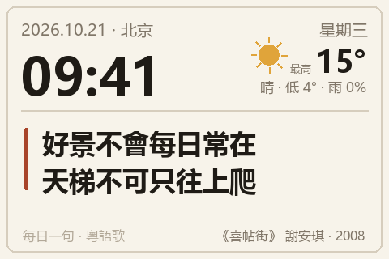
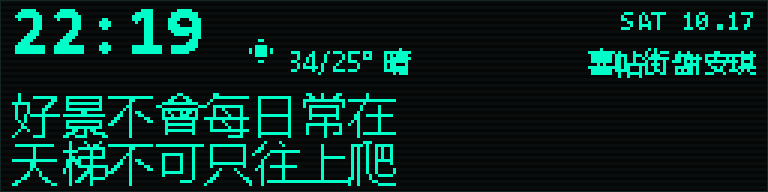
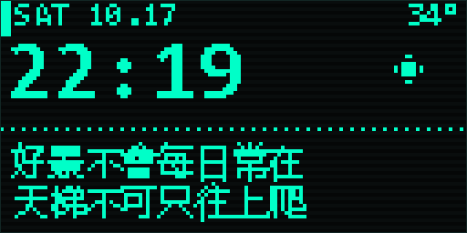
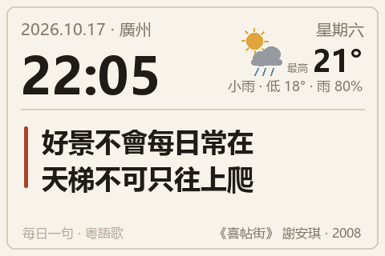

# 粵語天氣時鐘 · DIY 方案

一台放在桌上/牆上的天氣時鐘：顯示時間、今日天氣，**每天自動換一句粵語歌詞**——
鼓勵的、或者帶點哲理的。

關鍵要求是「歌不要都是爛大街那幾首」。所以這個方案的核心不是歌詞庫，
而是**一個每天跑一次的選歌 + 抓詞 + AI 挑句流水線**：曲庫裡只有歌名，
歌詞每次現抓，AI 只負責「挑」，不負責「背」。



## 线上地址（已部署）

| 用途 | 地址 |
|---|---|
| 网页版时钟（手机打开就能看） | https://lplush.github.io/weather-clock/ |
| 单片机拉的纯文本 | https://lplush.github.io/weather-clock/today.txt |
| 结构化数据 | https://lplush.github.io/weather-clock/today.json |
| 卡片图（彩屏路线） | https://lplush.github.io/weather-clock/card.png |

仓库：https://github.com/LplusH/weather-clock

每天 06:10（HKT）由 `daily.yml` 重新选词、抓词、生成 `today.txt`，
提交后 `pages.yml` 自动重新部署，设备下一次刷新就拿到新句子。

---

## 一、三條路線，先選一條

| | A 舊手機／平板 | B ESP32 + 屏 | C 墨水屏 |
|---|---|---|---|
| 難度 | ★☆☆☆☆ | ★★★☆☆ | ★★★★☆ |
| 成本 | 0–50 元（支架） | 約 130 元 | 約 250 元 |
| 動手時間 | 半小時 | 一個週末 | 兩個週末 |
| 效果 | 480×320 網頁，配色排版完全可控 | 真的像一件電器 | 停電也留著畫面，最省電 |
| 缺點 | 要一直插電、LCD 老化、舊系統瀏覽器可能太老 | 要接線、要配 TFT_eSPI | 刷新慢、不能顯示秒 |

**建議先做 A**：把 `site/index.html` 丟到手機上全屏，跑一週，確認你真的喜歡這個版面和節奏，
再決定要不要買硬件。A 和 B 共用同一份 `today.json` / `card.jpg`，不會白做。

> 如果你想要的是「賽博感」而不是「紙感」，**不要買彩屏**，直接看下面的
> **第五之二節：B2 路線：不要彩屏，要 OLED / 賽博風**，
> 採購細節在 [采购清单.md](采购清单.md)。

本倉庫三條路線的軟件都寫好了，硬件那份是骨架（見第五節）。

---

## 二、核心設計：為什麼要「AI 只挑不背」

直覺做法是：「讓 AI 每天想一句粵語歌詞」。**這個做法一定翻車**，
因為模型回憶歌詞極容易編造——句子讀起來很順、押韻也對，但原曲裡根本沒有這一句。
你不會逐首去核對，於是錯誤就長期掛在牆上。

所以流水線拆成兩步，把「創造」和「選擇」分開：

```
catalog.json          只有歌名/歌手/年份/熱度/標籤 —— 沒有任何歌詞
      │
      │  ① 選歌（本地邏輯：90 天不重複、避開高熱度、按天氣/星期傾斜）
      ▼
《喜帖街》謝安琪
      │
      │  ② 抓詞（LRCLIB 免費 API，抓到就寫進 cache/ 快取）
      ▼
忘掉種過的花 / 重新的出發 放棄理想吧 / ……（全文，逐行編號）
      │
      │  ③ AI 只看這份已編號的清單，回一個序號：{"line": 20, "why": "…"}
      ▼
line 20 → 「好景不會每日常在 天梯不可只往上爬」
      │
      │  ④ 校驗：序號在範圍內 → 取原文那一行（不是模型打的字）
      ▼
today.json + card.png / card.jpg
```

三個要點：

1. **輸出永遠等於抓到的原文**。模型只回一個整數，沒有機會改字、拼接、記錯。
2. **抓不到就換歌**，不硬編。沒有 API key 時自動退回關鍵詞評分（heuristic），流程不中斷。
3. **快取**。同一首歌只抓一次，`cache/` 進倉庫，之後離線也能跑。

> 如果你堅持要「AI 直接生成歌詞」，也行，但請務必保留 `④ 校驗` 那一步，
> 用它跟真實歌詞比對；比對不上的句子不要上屏。

---

## 三、曲庫怎麼建，才不會來來去去那幾首

`catalog.json` 目前 84 首，每首只有這些字段：

```json
{ "id": "s004", "title": "山林道", "artist": "謝安琪", "year": 2016,
  "hot": 2, "tags": ["堅持", "城市"] }
```

- **`hot` 熱度分級 1–5**：1 = 冷門，5 = 全民大熱。選歌時按 `hot` 升序排，
  `hot=5` 的只留 6 首當兜底。這是「不爛大街」的機制化保證，不靠自覺。
- **90 天冷卻**：同一首歌 90 天內不會再出現；曲庫 84 首 → 約三個月不重複。
  補到 365 首就是一年不重複（`--simulate 365` 可以直接驗證）。
- **同歌手隔離**：`hot` 一樣時，用日期雜湊打散，避免連續幾週都是陳奕迅。
- **天氣 / 星期傾斜**：下雨天偏「哲理 · 放下 · 孤獨 · 打氣」，星期一偏「打氣 · 堅持」，
  星期日偏「放下 · 無常」。見 `daily.py` 的 `WEATHER_TAGS` / `WEEKDAY_TAGS`。

**反面清單**（每年都被用濫的句子，建議整首不放進曲庫）：
《海闊天空》《紅日》《千千闕歌》《獅子山下》《一生何求》《愛得太遲》《陀飛輪》——
不是不好，是「一句歌詞」的價值在於**意外感**，這些句子已經被貼滿了小紅書。

想擴充曲庫的三個辦法：
1. 翻你喜歡的專輯的**非主打歌**（B-side、第三第四首）。
2. 按填詞人找：林夕、黃偉文、周耀輝、陳詠謙——同一個填詞人的冷門作品往往更耐讀。
3. 按年代補：1970s 許冠傑、1980s 達明一派、1990s 王菲／關淑怡、2000s 麥浚龍／何韻詩、
   2010s 之後的低調單位（Kolor、RubberBand、陳蕾、陳健安、方皓玟）。

---

## 四、每天怎麼跑（三種部署，選一個）

### A. GitHub Actions（推薦：零成本、不用開電腦）

`.github/workflows/daily.yml` 已經寫好：每天 06:10（HKT）跑一次，
提交 `site/today.json` 和 `site/card.jpg`，開 GitHub Pages 就有固定網址。

1. Fork / 新建倉庫，把 `weather-clock/` 推上去
2. Settings → Secrets 加三個：`WC_AI_BASE`、`WC_AI_KEY`、`WC_AI_MODEL`
3. Settings → Pages 選 `main` 分支 `/site` 目錄
4. 手機打開 `https://<你>.github.io/<倉庫>/`，加到主畫面全屏

> 注意：Actions 的 cron 是「盡量準時」，實際可能延遲 10–60 分鐘。當鬧鐘不行，當日曆可以。

### B. 樹莓派 / NAS / 家裡常開的電腦

```bash
# crontab -e
10 6 * * * cd /path/weather-clock && WC_AI_BASE=... WC_AI_KEY=... WC_AI_MODEL=... \
           /usr/bin/python3 pipeline/daily.py --render >> log.txt 2>&1
```
順便可以用 `python -m http.server 8000 -d site` 當局域網卡片服務器，給 ESP32 拉圖。

### C. 手動（先玩兩天看看）

```powershell
cd weather-clock
pip install pillow
$env:WC_AI_BASE  = "https://api.deepseek.com/v1"
$env:WC_AI_KEY   = "sk-..."
$env:WC_AI_MODEL = "deepseek-chat"

python pipeline\daily.py --render     # 選歌+抓詞+選句+出圖
python -m http.server 8000 --directory site
# 瀏覽器開 http://127.0.0.1:8000/
```

不設 `WC_AI_*` 也能跑，會用關鍵詞評分兜底（句子質量差一些，但流程通）。
`--no-ai` 可以強制走兜底，`--offline` 只讀快取，`--simulate 90` 只看未來排程不抓詞。

AI 費用：每天一次請求，一個月不到一分錢。想完全本地可以接 Ollama（`WC_AI_BASE=http://localhost:11434/v1`）。

---

## 五、硬件（B 路線）

| 件 | 型號 | 參考價 |
|---|---|---|
| 主控 | ESP32-S3 DevKit（N16R8，要 PSRAM） | ¥30 |
| 屏 | 3.5" 480×320 SPI，ST7796 / ILI9488 | ¥55 |
| 電源 | USB-C 5V/2A 電源 + 線 | ¥20 |
| 外殼 | 亞克力切割 / 3D 打印 / 舊相框 | ¥25 |
| 雜項 | 排針、杜邦線、熱縮管 | ¥5 |
| | **合計** | **約 ¥135** |

**中文顯示的坑，這裡繞過去了**：ESP32 沒有中文字庫，塞一套 24px 點陣要幾百 KB，
而且歌詞是繁體、字集天天變。本方案的解法是**後端畫好圖、設備只負責顯示**：

- `card.jpg`（480×320）含日期／星期／今日天氣／歌詞，一天生成一次
- **時:分留白**，由 ESP32 用內建 48px 數字字體每分鐘自己畫 → 零中文字庫
- 天氣顯示的是**今日預報**（最高／最低／降雨率），不是「此刻溫度」，
  所以卡片放一天也不會過時

固件在 `esp32/weather_clock/weather_clock.ino`，是**骨架**：
WiFi、NTP、HTTP 拉 JPEG、TJpg_Decoder 解碼、每分鐘重畫時間、掉線重連。
你只需要改三處（WiFi、`CARD_URL`、TFT_eSPI 的 `User_Setup.h`）。

---

## 五之二、B2 路線：不要彩屏，要 OLED / 賽博風

單色屏的像素預算和彩屏完全是兩回事，所以版面重畫了一份
（`pipeline/preview_oled.py`，直接按**真實像素**渲染，用來在下單前判斷塞不塞得下）。

**2.08 吋 256×64（推薦）**



**0.96–1.3 吋 128×64（不推薦）**



128×64 要塞下 16 字歌詞，字號必須壓到 10px，而「會、常、景」這種筆畫多的字就糊成一團了。
它只適合 8 字短句，或者做成從右往左的滾動字幕條。
256×64 用 16px 正文字，一句話兩行、筆畫清楚，是這幾塊屏裡唯一「像成品」的。

### 這條路線有一個繞不開的代價

彩屏那套「後端把卡片畫成 JPEG、設備只負責顯示」**在單色屏上失效**：
128×64 只有 1KB 像素，放不下排版好的圖；而且 1 bit 沒有抗鋸齒，字型糊不糊完全看字庫質量。

所以字必須由設備自己畫，於是撞上中文字庫問題：

- U8g2 自帶的中文字庫（`u8g2_font_wqy12_t_gb2312` 這類）是**簡體 GB2312**，
  歌詞是**繁體**——「願、謝、鐘、讓」根本不在字集裡。
- 塞整套 GBK（兩萬多字）要 400KB+，沒必要。

**解法：子集字庫。** 曲庫裡所有歌詞用到的字是有限的（84 首大概 1500–2500 個不同漢字），
連同 UI 固定字串一起，渲染成 12px / 16px 的 1-bit 點陣，輸出成 C 陣列放 PROGMEM：

| 字集 | 12px（24 B/字） | 16px（32 B/字） |
|---|---|---|
| 500 字 | 12 KB | 16 KB |
| 2000 字 | 48 KB | 64 KB |

不到 flash 的 5%，ESP32-C3 都裝得下。設備端拿到 UTF-8 後逐字查表、按碼位索引即可。
（這步還沒做，見最後一節。）

採購細節在 [采购清单.md](采购清单.md)：核心是 **ESP32-C3 SuperMini（¥18）＋ 2.08" SSD1322 256×64 SPI OLED（¥65）**，
約 ¥120。注意這條路線**不需要 PSRAM**——單色整屏才 2KB，上一版為了刷彩圖才必須買 N16R8。

---

## 六、版面



- 480×320，暖紙色 `#F7F3EA` + 墨色 `#1F1B16` + 一點朱紅做重音
- 上半：時間（最大）、日期星期、天氣（右上，圖示是代碼畫的，不依賴 emoji 字體）
- 下半：歌詞，左側一條朱紅豎線代替引號；右下角小字標出處
- 歌詞字號 33px，一行 ≤ 11 字，自動斷成 2 行（先在空格處斷句，不夠再硬切）
- 想換配色只改 `render_card.py` 頂部四個常數

時間那塊留白在 `TIME_X/Y/W/H`，要和固件裡的同名列對得上。

---

## 七、施工步驟

**30 分鐘（A 路線跑起來）**
1. `pip install pillow`
2. 跑 `python pipeline/daily.py --render`
3. `python -m http.server 8000 --directory site`
4. 手機打開，加到主畫面，全屏

**半天（加上自動化）**
5. 推上 GitHub，配 Secrets + Pages，等第二天早上看結果
6. 調 `catalog.json`：把你嫌俗的歌 `hot` 改成 5，把喜歡的冷門歌 `hot` 改成 1

**一個週末（做成硬件）**
7. 買屏，先用 TFT_eSPI 的範例點亮、確認顏色順序（RGB/BGR 常搞反）
8. 改 `User_Setup.h`，跑固件；先把 `CARD_URL` 指向電腦上的 `card.jpg`
9. 做外殼，藏線，找個順眼的位置

---

## 八、坑位清單

| 坑 | 現象 | 對策 |
|---|---|---|
| 中文字體缺失 | Linux 上出方塊 | `apt install fonts-noto-cjk`；`FONT_CANDIDATES` 已列常見路徑 |
| 繁體/簡體 | 抓到繁體、你寫簡體 | 一律以抓到的原文為準，卡片用繁體（粵語歌詞本來就是繁體） |
| 歌詞源沒有這首 | 抓詞失敗 | 換歌重跑；或手動把歌詞丟進 `cache/sXXX_歌名.txt` |
| 歌詞源限流 | 偶發 429 | `cache/` 已有快取，同一首只抓一次；別並發 |
| Actions 不準時 | 06:10 變 07:00 | 正常，cron 是盡量；要準時用 NAS |
| 屏幕燒印 | 幾個月後見殘影 | 深夜降亮度／整點做一次全屏反色／用墨水屏 |
| 斷網 | 卡片不更新、時間還在 | 固件保留上一張圖，時間靠本地 RTC 走 |
| 顏色反了 | 藍天變橘天 | TFT_eSPI 裡 `TFT_RGB_ORDER` 改 `TFT_BGR` |
| 記憶體爆 | 顯示一半花屏 | 用 JPEG 不用裸 RGB（480×320×2 = 300KB，扛不住） |

---

## 九、文件結構

```
weather-clock/
├── catalog.json                    曲庫：84 首歌的元數據，沒有歌詞
├── config.json                     經緯度/城市/時區
├── pipeline/
│   ├── daily.py                    選歌 → 抓詞 → AI 選句 → 校驗 → today.json
│   ├── render_card.py              today.json + 天氣 → card.png / card.jpg
│   └── preview_oled.py             單色 OLED 版面預覽（真實像素，採購前看）
├── site/                           可以直接發佈的靜態站（GitHub Pages 用這個目錄）
│   ├── index.html                  A 路線：舊手機/瀏覽器全屏時鐘（自己抓實時天氣）
│   ├── today.json                  今日結果（機器讀）
│   ├── card.png / card.jpg         B 路線：彩屏設備拉這張圖
│   ├── oled-256.png / -zoom.png    B2 路線：2.08" 256×64 版面
│   ├── oled-128.png / -zoom.png    B2 路線：0.96" 128×64 版面
│   └── preview*.png                彩屏效果圖
├── esp32/weather_clock/            B 路線固件骨架
├── cache/                          歌詞快取（運行後生成，建議進倉庫）
├── state/history.json              用過的歌，避免 90 天內重複
└── .github/workflows/daily.yml     每天定時跑
```

命令速查：

```bash
python pipeline/daily.py                      # 今天
python pipeline/daily.py --date 2025-06-01    # 補某天
python pipeline/daily.py --simulate 90        # 只驗證排程，不抓詞
python pipeline/daily.py --offline --no-ai    # 全離線
python pipeline/daily.py --render             # 順便出圖
python pipeline/render_card.py --preview      # 只重畫圖
```

---

## 十、版權與合規（必讀）

- 歌詞著作權屬於填詞人與唱片公司。**個人自用**（自己家牆上、自己手機）摘一句、
  標明出處，一般屬於合理使用範疇；但**不要**把它做成公開歌詞庫、
  不要用於商業展示或產品預裝、不要整首轉載。
- LRCLIB 是社群維護的免費開放接口，請尊重其速率限制，並保留本地快取。
- 如果你打算把這個時鐘送人／賣掉，最穩的做法是：曲庫只放**你自己寫的句子**
  或**已進入公有領域**的作品（如 1930 年代前的粵曲）。
- AI 生成的「解讀」可以自由使用，但歌詞原文不行。

---

## 十一、還能怎麼加

- **節日/生日特供**：`daily.py` 裡加一條規則，命中日期就從指定歌單裡選。
- **天氣聯動更狠**：暴雨天自動選「撐」類句子，並在卡片加一行小字。
- **粵拼注音**：給歌詞加一行 Jyutping，學粵語的人會很喜歡（`ToJyutping` 現成庫）。
- **一週回顧**：`state/history.json` 已經在記，順手能生成「這週的七句」長圖。
- **按鈕換一句**：加一顆實體鍵，短按從候選行裡再抽一句（不影響當天記錄）。

---

需要的話我可以繼續往下做：把曲庫補到 365 首、加粵拼、
或者把固件改成用 LVGL 直接畫（不依賴後端出圖）。
