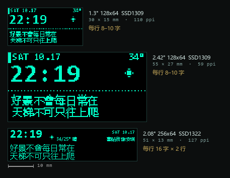

# 採購清單（OLED / 賽博風版）

> 買在哪家、什麼價位、怎麼防坑 → 見 [采购渠道.md](采购渠道.md)。

不用液晶屏，改成單色 OLED 或點陣屏。**先看效果圖再下單**：
`site/oled-256-zoom.png`（推薦的 2.08 吋）和 `site/oled-128-zoom.png`（0.96–1.3 吋）。

三塊屏按**真實物理尺寸**並排（左下角有 10mm 比例尺）：



---

## 一、先說結論

| 方案 | 屏 | 一行能放幾個中文字 | 觀感 | 價格 | 建議 |
|---|---|---|---|---|---|
| **A** | 2.08" 256×64 OLED（SSD1322, SPI） | **16 字**（16px） | 寬條儀錶盤，最像終端機 | ¥65 | ★★★★★ 首選 |
| **B** | 2.42" 128×64 OLED（SSD1309, SPI） | 10 字（12px） | 字大、點粗，復古終端 | ¥50 | ★★★☆ 近距離看 |
| **C** | 0.96"/1.3" 128×64 OLED（SSD1306, I2C） | 10 字（但 10px 起筆畫就糊了） | 極簡 | ¥20 | ★★ 只能顯示 8 字短句 |
| **D** | P3 64×32 全彩 LED 點陣（HUB75） | 8 字（12px） | **最賽博**，霓虹掃描 | ¥90–140 | ★★★★ 想要「街機味」選這個 |
| E | 4" 方形彩屏（GC9A01 圓屏等） | — | 還是 LCD | ¥40 | 你已經排除 |

**我推薦 A。** 256×64 剛好是「一行歌詞 + 一行時間」的比例，16px 中文筆畫清楚，
不用滾動字幕就能把一整句放下（今天的 16 字歌詞剛好一行）。

> 128×64 的實測結論：要塞 16 字歌詞，字號必須壓到 10–11px，
> 而 10px 的「會、常、景」這類筆畫多的字已經糊成一團（看 `oled-128-zoom.png` 就知道）。
> 所以 128×64 只適合「一句 8 字左右」的極簡版，或者做成**從右往左滾動**的字幕條。

---

## 二、方案 A 採購單（2.08" 256×64 OLED）

| # | 買什麼 | 規格要點 | 數量 | 參考價 | 淘寶搜 |
|---|---|---|---|---|---|
| 1 | **ESP32 開發板** | **ESP32-C3 SuperMini**（夠用、便宜）或 **ESP32-S3 Mini** | 1 | ¥18–30 | `ESP32-C3 SuperMini` |
| 2 | **2.08 吋 OLED 模組** | 256×64，**SSD1322**，**SPI 接口**（不是 I2C） | 1 | ¥55–75 | `2.08寸 OLED 256x64 SSD1322 SPI` |
| 3 | USB-C 電源 | 5V/1A 就夠（OLED 很省） | 1 | ¥12 | `5V1A 充电头` |
| 4 | USB-C 數據線 | 要能傳數據 | 1 | ¥10 | — |
| 5 | 杜邦線 | 母對母 20cm | 1 | ¥5 | — |
| 6 | 外殼 | 亞克力 / 3D 打印 / 舊收音機殼 | 1 | ¥0–30 | — |
| | | | | **約 ¥120** | |

**注意兩件事：**

- **認準 SSD1322**。同樣叫「2.08 寸 256×64」，有人賣 SSD1322（16 級灰、SPI），
  也有人賣 SSD1362/SPI 4-wire，驅動庫不一樣。下單前問：**「是 SSD1322 嗎？支援 4 線 SPI 嗎？」**
- **這條路線不需要 PSRAM**。單色屏整屏緩衝才 2KB，上一版為了刷彩圖才必須買 N16R8。
  省下來的錢剛好補貼屏價。

### 接線（SPI，6 根）

| OLED | ESP32-C3 | 說明 |
|---|---|---|
| VCC | 3V3 | 別接 5V |
| GND | GND | |
| SCK / D0 | GPIO4 | 時鐘 |
| SDA / D1 | GPIO6 | 數據（MOSI） |
| CS | GPIO7 | 片選 |
| DC | GPIO5 | 數據/命令 |
| RES | GPIO10 | 復位 |

（ESP32-S3 用 GPIO12/11/10/9 對應，和上一版 TFT 那套一樣。）

---

## 三、方案 D 採購單（P3 64×32 全彩點陣，最賽博）

想要「霓虹燈牌 / 街機 / 車站顯示屏」那種味道，單色 OLED 給不了。這條：

| # | 買什麼 | 規格 | 價 | 搜 |
|---|---|---|---|---|
| 1 | ESP32-S3 Mini | 有 PSRAM 更好 | ¥30 | `ESP32-S3 Mini` |
| 2 | **P3 全彩 LED 單元板** | 64×32 點，HUB75 接口，室內款 | ¥55–90 | `P3 全彩 LED单元板 64x32 HUB75` |
| 3 | **HUB75 轉接板 / 16P 排線** | 有些板自帶 IDC 座，沒有就買 | ¥10–15 | `HUB75 转接板 ESP32` |
| 4 | 5V/4A 電源 | 點陣全亮很吃電流，**別用 1A** | ¥25 | `5V4A 电源` |
| 5 | 外框 | 黑色亞克力，讓點陣「浮」在黑底上 | ¥30 | — |
| | | | **約 ¥160** | |

- 庫存庫：`ESP32-HUB75-MatrixPanel-DMA`（比 PxMatrix 好用得多，支援 DMA 不閃）
- 8×8 的漢字在 64×32 上只能放 4 個字一行、2 行，適合**滾動字幕**
- 亮度高，白天也看得清，這點比 OLED 強

---

## 四、可選件

| 買什麼 | 用途 | 價 |
|---|---|---|
| 6×6 輕觸開關 ×3 | 手動換一句 / 切換資訊頁 | ¥2 |
| 光敏電阻 GL5528 + 10k | OLED 夜間自動降亮度（晚上不會刺眼） | ¥2 |
| M2.5 銅柱螺母 | 固定 | ¥8 |
| 黑色亞克力 2mm（激光切割） | 「黑底發光」的關鍵，比 3D 打印好看 | ¥25 |
| 3M 雙面膠 / 熱熔膠 | 裝配 | ¥10 |

---

## 五、驅動 IC 對照（買之前先確認這一行）

同樣叫「OLED 模組」，驅動 IC 不同，庫和初始化序列就不同：

| 驅動 IC | 分辨率 | 常見尺寸 | 接口 | 能不能用 |
|---|---|---|---|---|
| **SSD1306** | 128×64 | 0.96" | I2C / SPI | ✅ U8g2 `SSD1306_128X64_NONAME` |
| **SSD1315** | 128×64 | 0.96" / 1.3" | 多為 I2C | ✅ **指令兼容 SSD1306**，用同一個構造器 |
| **SSD1309** | 128×64 | 2.42" | SPI | ✅ `SSD1309_128X64` |
| **SSD1322** | **256×64** | 2.08" / 3.12" | SPI / 並口 | ✅ `SSD1322_NHD_256X64`（本方案首選） |
| SSD1327 | 128×128 | 1.5" 方形 | SPI / I2C | ✅ `SSD1327_128X128` |
| SSD1362 | 256×64 | 2.08" | SPI | ⚠️ 同解析度但**不是** SSD1322，U8g2 支援較少，慎買 |

**SSD1315 能不能用？——能，但那是「驅動層面能用」。**
它和 SSD1306 指令集兼容（本質是降本替代品），U8g2 用 SSD1306 的構造器直接跑；
但它只做到 **128×64**，所以「一行 8–10 個中文字」的物理限制不變。
適合當**試水/驗證字庫**，不適合當成品。

反過來說：**判定「夠不夠用」的不是 IC，是解析度。**
1315 / 1306 / 1309 都是 128×64，資訊量完全一樣，差別只在點的大小和接口速度。

### 要不要買「帶字庫」的版本？—— 不用

「帶字庫 / 不帶字庫」這個選項主要出現在 **LCD12864（ST7920）** 和 **串口屏** 上；
2.08" OLED 這類模組本身幾乎沒有帶字庫的版本。就算有，也不該買：

| 帶字庫版 | 我們的方案 |
|---|---|
| 字庫是 **GB2312 簡體**，缺「願、謝、鐘、讓」這些繁體字 | 字庫自己生成，繁體全覆蓋 |
| 字形固定 16×16 宋體，不能換字號、不能改字重 | 12px / 16px 兩套，想換就重新生成 |
| 貴 ¥10–20，還多一顆芯片佔位 | 0 成本，字庫進 flash |
| 部分型號鎖死並口/特定指令 | 標準 SPI，U8g2 直接驅動 |

唯一例外：如果你買的是**串口屏/智能屏**（自帶 MCU 和組態軟件），那架構變成
「ESP32 發指令、屏自己渲染」——能省事，但貴、排版自由度差、做不出想要的點陣味道，不推薦。

---

## 六、千萬別買

| 別買 | 原因 |
|---|---|
| 0.96 吋 I2C OLED 想顯示整句歌詞 | 只能顯示 8 字，文字一糊就毀了整個效果 |
| I2C 介面的 2.42 吋 OLED | 重新整理太慢，會看到一條條刷新線 |
| 「2.8 吋 256×64」實際是 SSD1322 但標 SPI 卻是 I2C 版本 | 下單前必須問清接口 |
| P3 面板配 5V/1A 電源 | 全亮會掉電壓，屏幕出現花屏或重啟 |
| 便宜的「ESP32 + 屏」一體模組 | 解析度多為 170×320 之類的怪比例，排版要重做 |

---

## 七、下單順序

1. **先買 1、3、4、5**（約 ¥45）：板子連上 WiFi、串口打印今日歌詞，證明軟件通。
2. **買屏**（第 2 項）：這是唯一「買錯就浪費」的件，確認 SSD1322 + SPI 再付款。
3. **外殼最後做**：等畫面跑起來再量尺寸。

---

## 八、屏到了先燒測試固件

先別急著寫天氣時鐘。**第一步是把屏點亮**，把「接線 / 驅動 IC / 有沒有壞點」確認掉：

```
esp32/screen_test/screen_test.ino
```

改文件頂部的一個 `#define` 選屏（SSD1322 256×64 / SSD1309 128×64 / SSD1306·1315 128×64），
燒進去它會自動跑 8 項測試：全亮全滅、棋盤格、邊框角標、灰階、字號、中文、動畫 FPS、對比度掃描。
每一步都同時往串口打一行說明，所以**屏全黑也能從串口知道卡在哪一步**。

依賴庫：U8g2。

---

## 附：如果你改主意回到彩屏
TFT 版（480×320，能顯示完整排版好的彩色卡片）的單子見本文末的舊版本，
核心是 `ESP32-S3 N16R8` + `3.5 吋 ST7796S SPI 屏`，約 ¥150。
兩條路線的**軟件是分開的**：TFT 版把卡片烘焙成 JPEG 推給設備（不需要字庫），
OLED 版必須在設備上自己畫字（需要子集點陣字庫，見 README）。
